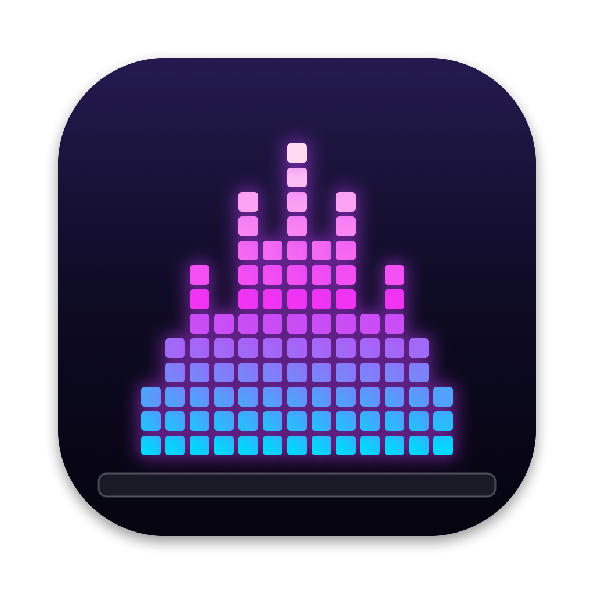
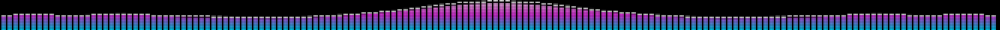
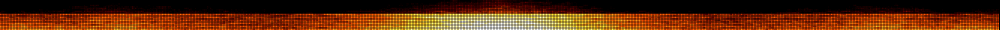
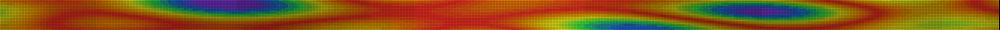
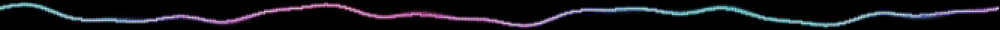
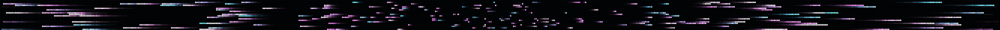
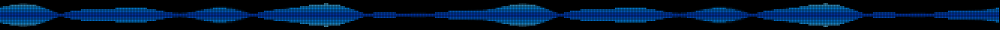
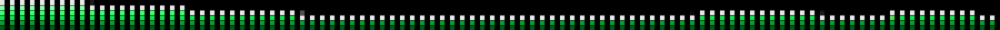

<p align="center">
  
</p>

<h1 align="center">BeatBar</h1>

<p align="center">
  A pixel-art music visualizer for your MacBook Pro's Touch Bar.<br>
  It moves with whatever's playing on your Mac, or animates on its own.
</p>

<p align="center">
  <a href="https://github.com/yaksh1010/BeatBar/releases/latest/download/BeatBar.dmg"><b>⬇️ Download BeatBar.dmg</b></a>
</p>

---

<p align="center"></p>
<p align="center"></p>
<p align="center"></p>
<p align="center"></p>
<p align="center"></p>
<p align="center"></p>
<p align="center"></p>

<sub>The demos use simulated music. Rendered with <code>./build.sh --demo</code>.</sub>

## Make it yours

Open BeatBar to get a settings window with a **live preview** of your Touch Bar. Every change shows up on the
Touch Bar straight away.

| | Options |
|---|---|
| **Visual** | Bars · Wave · Fire · Stars · Plasma |
| **Wave shape** | Line · Filled · Mirrored |
| **Movement** | **Music Sync** (follows Spotify, YouTube, Apple Music, anything) or **Constant Movement** (animates on its own, no permission needed) |
| **Colors** | Neon · Sunset · Matrix · Ocean · Lava · Candy · Mono · Rainbow · **Custom** (pick your own 3 colors) |
| **Pixels** | Tiny → Huge pixel size, LED grid, brightness, afterglow trail |
| **Extras** | Mirror (bass in the middle), falling peak dots, sensitivity, animation speed, show automatically when music starts, launch at login |

**On the Touch Bar:** swipe to change style · tap to change colors · drag your finger to throw sparks ·
✕ to close. The waveform button in the Control Strip brings it back.

## Requirements

- A MacBook Pro **with a Touch Bar** (2016–2022, Apple Silicon or Intel)
- macOS 14.2 Sonoma or later (tested on macOS 26.2 with an M1)

## Install

1. [Download BeatBar.dmg](https://github.com/yaksh1010/BeatBar/releases/latest/download/BeatBar.dmg), open it and drag **BeatBar** into **Applications**.
2. Open BeatBar. It isn't notarized by Apple, so macOS blocks it the first time:
   - Click **Done** on the warning.
   - Open **System Settings → Privacy & Security**, scroll down and click **Open Anyway** next to BeatBar.
   - Or run this once in Terminal instead:
     ```bash
     xattr -dr com.apple.quarantine /Applications/BeatBar.app
     ```
3. For **Music Sync**, click **Allow** when macOS asks about recording system audio. If you clicked Don't Allow,
   go to System Settings → Privacy & Security → Screen & System Audio Recording → System Audio Recording Only,
   and turn on BeatBar.

If the visualizer doesn't appear, go to System Settings → Keyboard → Touch Bar Settings, set *Touch Bar shows*
to **App Controls** and turn on **Show Control Strip**.

## Privacy

Music Sync uses a Core Audio *process tap* (macOS 14.2+) to read the audio your Mac is playing, turns it into
frequency levels, and throws the samples away right after. Nothing is recorded or saved, and BeatBar has no
network code. Constant Movement doesn't touch audio at all.

## How it works

| File | What it does |
|---|---|
| [`Audio.swift`](Sources/Audio.swift) | System audio tap, FFT spectrum and beat detection |
| [`Renderer.swift`](Sources/Renderer.swift) | Draws each style into a tiny pixel grid (e.g. 666 × 20) |
| [`PixelViews.swift`](Sources/PixelViews.swift) | Scales that grid up crisply with LED gaps; Touch Bar touch controls |
| [`Settings.swift`](Sources/Settings.swift) | Saved choices, color themes, simulated music for Constant Movement |
| [`SettingsView.swift`](Sources/SettingsView.swift) | The SwiftUI settings window and live preview |
| [`AppDelegate.swift`](Sources/AppDelegate.swift) | Touch Bar presentation, frame loop, menus |

The Touch Bar and the preview draw the same image, so the preview is exact. Showing a Touch Bar from a
background app needs private AppKit APIs, the same approach used by [Pock](https://github.com/pock/pock) and
[MTMR](https://github.com/Toxblh/MTMR). That's why BeatBar can't be on the Mac App Store, and why a
future macOS update could break it.

## Build from source

Needs Xcode (or the Command Line Tools).

```bash
git clone https://github.com/yaksh1010/BeatBar.git
cd BeatBar
./build.sh --install    # build, copy to /Applications, launch
```

- `./build.sh --dmg` makes `dist/BeatBar.dmg`.
- `./build.sh --demo` re-renders the GIFs in `docs/`.
- `swift scripts/make-icon.swift` redraws the icon.
- Sign with your own certificate so the audio permission survives rebuilds:
  `SIGN_IDENTITY="Apple Development: Your Name (TEAMID)" ./build.sh --install`

## License

[MIT](LICENSE)
